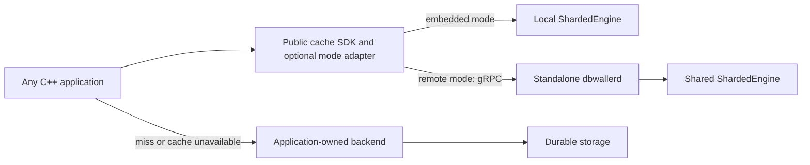

# DBWaller daemon bridge implementation plan

Status: PR 1 foundation and PR 2 daemon implemented locally, 2026-11-11;
client packaging and later stages remain planned.
C++ is the first remote client;
Python and Node.js follow after the protocol and C++ integration are stable.
This document describes the roadmap. The implemented protocol/service boundary
is documented in [Bridge service contract](bridge-service.md); build/run the
experimental daemon using [Run the daemon](daemon.md).

## Objective and existing foundations

Ship an open-source cache toolkit that any project can install and operate:

- `DBWaller::dbwaller`: the existing embeddable C++20 library.
- `dbwallerd`: a standalone cache process, distributed independently of applications.
- A separately installable C++ remote SDK; Python and Node.js SDKs follow later.

Retain the repository's MIT license for first-party code and include required
dependency notices in distributions. Public installation, documentation, examples,
and CI must work without Wahalao-web, HydraStack, Drogon, private repositories,
Google Cloud accounts, or application-specific credentials.

The local checkout already provides invalidation-safe load tickets, generation-aware
single-flight, lifecycle controls, and an observer. `apps/dbwaller_daemon/` now
contains the service and optional gRPC listener. The value-byte budget and entry
count bound cache growth, rather than representing a total process memory ceiling.

The first reference integration is Wahalao-web's C++/Drogon server. Its existing
`DbwallerService`, coroutine coordinator, and `docs/dbwaller-integration.md` already
use load tickets, bounded waits, identity-aware keys, and explicit freshness
policies. Preserve these contracts during migration. In particular, permission-
sensitive reads currently revalidate with the gateway, and public search-trend
aggregates are the initial bounded-staleness use case.
These are application requirements for that adapter; they must not become
mandatory SDK policies, dependencies, cache-key formats, or deployment choices.



Database writes remain in the owning services. The cache stores reconstructible
data; it must not become the only copy of a post, message, account, or transaction.

## Architecture decisions

1. Use a versioned gRPC/Protobuf API for the first bridge. Binary values and typed
   outcomes fit the C++ integration and future Python/Node.js clients. Use async
   C++ callbacks, reusable channels, and explicit RPC deadlines. Expose an executor
   or completion-dispatch hook for optional framework/coroutine adapters. The SDK
   must not depend on a particular event loop.
2. Keep transport dependencies out of the embedded library. Add separate daemon
   and remote-client targets with explicit build options, defaulting off for
   library consumers. An embedded-only Conan/CMake build must not require gRPC,
   Protobuf, a socket listener, or an application framework.
3. Keep upstream fetching in the application for v1. The daemon receives opaque
   cache values and invalidations; it does not execute client callbacks, proxy
   arbitrary URLs, or hold database credentials. Existing embedded adapters stay
   available.
4. Retain one engine-wide invalidation generation initially. Record how often
   unrelated invalidations reject publications before considering dependency-aware
   generations. Do not add a second generation mechanism in the network layer
   that can disagree with the engine's final publication check.
5. Deploy one daemon with cold starts. Defer snapshots, replication, automatic
   failover, Redis command compatibility, and cross-process load leases.

## Public distribution and developer experience

The target/package names below are proposed interfaces, not currently published
packages or installation commands.

| Deliverable | Installation and dependency boundary |
| --- | --- |
| Embedded engine | Preserve the existing Conan/CMake library and `DBWaller::dbwaller` target; no networking dependency required. |
| Remote C++ SDK | Provide a versioned Conan 2 package and relocatable CMake package, with proposed `DBWallerRemote::client` target. A remote-only application does not link the engine or daemon and need not handle generated gRPC stubs directly. |
| Daemon | Publish versioned source releases, a documented Linux build, and a public container image with runnable sample configuration. Keep localhost development and non-Google deployment supported. |
| Google Cloud deployment kit | Provide a documented `deploy/gcp/` installer and reusable Terraform configuration that deploy into the user's own project, with private connectivity, configuration outputs, upgrade, and removal workflows. |
| Python and Node.js SDKs | Later publish installable packages through PyPI and npm, sharing protocol conformance fixtures and documented client/server compatibility. |

The intended CMake consumer experience is:

```cmake
# Planned usage after the remote SDK has been implemented and packaged.
find_package(DBWallerRemote CONFIG REQUIRED)
target_link_libraries(my_app PRIVATE DBWallerRemote::client)
```

Provide a small, framework-independent example under `examples/remote_cpp/` that
uses a simulated backend. Its tutorial must cover installation, starting a local
daemon, connecting, lookup/fetch/conditional publication, invalidation, and cache
outage fallback. It must run from public artifacts in a fresh environment, without
developer-machine paths or a sibling application checkout.

Offer explicit `disabled`, `embedded`, and `remote` modes through an optional
application-facing adapter. Disabled mode skips caching; embedded mode links the
engine; remote mode uses the client package. Remote-only consumers must not acquire
the engine merely to configure a mode. Keep native and remote tickets opaque and
distinct under that abstraction. Make backend fetching, authorization, freshness,
and retry budgets application-supplied policies, with documented examples.

Document namespace isolation, TLS/credentials, lifecycle and thread-safety rules,
client/server compatibility, errors, upgrades, and supported platforms. Initially
validate Linux and macOS C++ consumers; do not claim untested Windows support.
Publish a supported install route with releases rather than assuming ConanCenter
acceptance. Keep optional packages in separate recipes or correctly distinguish
their package IDs so consumers cannot receive incompatible cached artifacts.

The public SDK release gate is an unrelated minimal application installing the
package and passing the example against a local daemon. Wahalao-web integration
must not be a prerequisite for installation or use.

### Google Cloud installation experience

A user with a Google Cloud project should be able to deploy a pinned DBWaller
release without learning its internal build or inventing infrastructure scripts.
Provide a Cloud Shell-compatible quickstart and an inspectable deployment kit
under `deploy/gcp/`, backed by reusable Terraform configuration. The guided entry
point and direct Terraform usage must share the same resource definitions.

The intended flow is:

1. Select the project, region/zone, deployment name, release, VM size, and cache
   budget. Choose an existing VPC/subnet or an explicitly created dedicated one.
2. Check authentication, billing, API availability, quotas, and required IAM
   permissions. Explain missing prerequisites without granting broad roles or
   changing the user's default gcloud project silently.
3. Preview the resources and regional cost components, then apply the deployment
   explicitly. Include VM, disk, registry, logging, and any necessary network costs;
   do not imply that an account makes deployment free.
4. Provision one private VM, reserved internal endpoint, scoped runtime service
   account, firewall rules, TLS/credential references, and the pinned daemon image.
   Use startup scripts or cloud-init rather than the retired container startup
   agent. Do not put secrets in source, VM metadata, command output, or Terraform
   outputs; have the runtime read authorized secrets from Secret Manager.
5. Verify readiness from an authorized VPC client and emit the endpoint, namespace,
   CA/trust configuration, secret references, and sample C++ client configuration.
   Provide explicit Cloud Run Direct VPC and Compute Engine client instructions;
   changing an existing application's network settings is a separate opt-in step.
6. Provide status, logs, upgrade/rollback, and uninstall commands. Preview changes,
   retain deployment state, and delete only resources owned by that deployment.
   A single-node upgrade may cause a cold cache and temporary backend fallback.

A VM without an external address still needs a supported image/bootstrap path.
Document copying the public release image into the customer's Artifact Registry
and pulling it with the runtime identity over Private Google Access. Identify any
remaining internet-egress requirement explicitly; do not silently add Cloud NAT
and its costs or assume a private VM can pull from a public registry.

Use versioned image digests, supported OS images, idempotent boot configuration,
and documented credential/certificate rotation. Test first install, a repeated
apply, upgrade, rollback, and teardown in a clean project using public release
artifacts. No maintainer-owned cloud project or Wahalao service may be required.
This is self-hosted software in the user's project, with operating costs and
maintenance owned by that user; it is not a managed DBWaller service.

Redis-like deployment means a shared server process with clients. Supporting
Redis clients would additionally require RESP and compatible command semantics;
that is a separate feature, not implied by opening a TCP port.

## Storage decision

Use RAM for live cache entries, a normal VM boot disk for the operating system and
daemon runtime, and optional Google Cloud Storage (GCS) objects for future portable
snapshots. Do not require Filestore or a snapshot bucket for the first release.

| Layer | Choice | Release scope |
| --- | --- | --- |
| Active cache values, indexes, and load tickets | Bounded process RAM | V1; lookups and publication do not perform storage I/O. |
| VM operating system, runtime, and bounded temporary files | Boot Persistent Disk compatible with the chosen VM/OS; start with `pd-balanced` on the proposed E2 deployment | V1; leave headroom for images, upgrades, and logs. This does not persist the in-memory cache. |
| Local snapshot staging | Optional bounded directory on a writable disk filesystem; use ext4 for a separately provisioned Linux data disk if needed | Later; no extra data disk required initially. |
| Portable cache snapshots | Optional GCS bucket in the deployment region, using object APIs and an appropriate storage class such as Standard for frequently restored snapshots | Later, after restore consistency is defined. |
| Shared NFS storage | Filestore is not part of the initial architecture | Reconsider only for an actual shared-file/POSIX requirement. |
| Authoritative application records | The application's existing durable datastore | Always outside the cache's durability contract. |

GCS is object storage, suitable for complete snapshot objects and manifests. It is
not the live key/value engine or a requirement for running DBWaller. Filestore is
a managed shared file service; this single-daemon cache has no shared-file access
requirement that justifies adding it. Mounting GCS through FUSE does not supply
general POSIX semantics and is not the proposed cache or snapshot-write interface.

V1 starts empty after restart and refills from the application's backend. A
Persistent Disk retains disk data under its configured lifecycle, not process RAM;
VM/disk deletion settings must be explicit in deployment and uninstall procedures.
Do not describe a boot-disk backup as a DBWaller cache snapshot.

When snapshots are implemented:

- Make persistence opt-in. Preserve a local-file option for non-Google users and
  put the GCS uploader/downloader in an optional component so the embedded engine
  and remote client do not acquire a mandatory Google Cloud dependency.
- Upload complete, versioned snapshots with checksums, schema metadata, and
  original expiration times. Define a consistent export point across publication
  and invalidation; do not hold engine locks during disk/network I/O.
- Gate restore on the backend-version/invalidation-replay policy described below.
  A non-expired entry can still have been invalidated while the daemon was down.
  Snapshot durability alone is not permission to serve it again.
- Restore into a new engine lifetime, reject all prior load tickets, never reset
  TTLs, and fall back to an empty cache if the snapshot is absent, corrupt,
  incompatible, or cannot be validated within the startup budget.
- Document bucket access, retention/lifecycle cleanup, storage/operation/transfer
  costs, and teardown behavior. A failed snapshot upload must not stop live cache
  requests. Snapshot support does not imply replication or automatic failover.

## First protocol contract

The versioned service lives under `proto/dbwaller/v1/`. The listener uses the field
numbers, limits, and status mappings documented in the service and daemon guides.

| Operation | Required behavior |
| --- | --- |
| Lookup | Return fresh/stale/miss and opaque bytes with documented TTL/SWR metadata; provide an optional atomic lookup-and-ticket mode for fetch/derived-write workflows. |
| BeginLoad | Capture an engine ticket before an external fetch when a snapshot is unnecessary. |
| Publish | Validate an opaque remote ticket, then call the engine's conditional publication API. Return an explicit stored/invalidated/expired/consumed outcome. |
| InvalidateKey / InvalidateTag | Apply engine invalidation even if no entry or tag index exists. Acknowledge only after completion. Scope keys and tags to the authenticated namespace. |
| Health / Stats | Expose readiness, protocol/build version, and bounded aggregate counters. Protect operational access; do not expose raw cached values through diagnostics. |

Use Protobuf `bytes` for opaque values and binary-safe key encodings. Leave
application key dimensions and freshness-envelope formats to the consumer. Define
duration units and maximum TTLs; never send process addresses or raw steady-clock
timestamps as portable state. Keep invalidation and ticket expiration distinct
from transport failure, bad input, denied access, and capacity exhaustion.

Unconditional `put()` remains an embedded deliberate-write API. Do not expose a
generic remote unconditional write in the first protocol.

### Remote tickets and retries

- Keep a bounded server-side table from cryptographically random ticket IDs to
  the real engine `LoadTicket`, authenticated namespace/principal, and expiration.
  Do not serialize the engine's private shared-pointer identity.
- Tickets are scoped to the daemon process lifetime. Restarting creates a new
  instance identity and invalidates all outstanding tickets, even if the VM and
  IP address remain the same. A different server cannot accept them.
- Define ticket expiration against server monotonic time. Bound both retained
  ticket count and retained key bytes; expire abandoned tickets incrementally.
  Coordinate ticket lifetime with the configured fetch deadline and publication
  margin. Expired tickets require a new fetch, not reticketing an old result.
- Make remote tickets single-use for publication. Concurrent/replayed publication
  attempts cannot extend TTL or resurrect a value after invalidation. This is a
  stricter wire contract than the reusable embedded ticket.
- Do not automatically retry publication in v1. If its reply is lost, the client
  must treat the outcome as unknown; an RPC timeout does not prove the server
  performed no write. A consumed or unknown ticket must never trigger an
  unconditional write. A later retry design can add a bounded receipt ledger.
- A read deadline covers queueing, connection establishment, response transfer,
  and decoding within the application's remaining request budget. Cancellation
  releases client-owned work without claiming to undo completed server mutations.

Tickets are publication guards, not distributed load leases. In v1 two application
instances may fetch the same cold key independently. Preserve each integration's
local coalescing and its bounds; add cross-process coalescing only after measuring the
need and designing lease expiry, fencing, waiter limits, and crashed-owner recovery.

## Ordered implementation work

### PR 1 — Contract and transport-independent service (implemented locally)

- Add the versioned protocol and a service facade over `ShardedEngine`.
- Implement bounded remote-ticket ownership, expiry, and conditional publication.
- Provide a coherent lookup-and-ticket operation for workflows that read a
  snapshot before deriving a write; add an additive core helper if needed to
  linearize both under the existing publication mutex.
- Add deterministic tests for absent-key/tag invalidation, old/new loads,
  single-use tickets, wrong namespace, expiry, and a new daemon instance.
- Keep existing embedded tests and downstream Conan consumer validation green.

Done when service-level tests reject every obsolete publication while accepting
a fresh load, with no network or external backend required. The basic protocol
fixture becomes shared conformance material for later clients.

### PR 2 — Daemon executable and local network proof (implemented locally)

- Add `dbwallerd`, validated configuration, an async gRPC listener, health, and
  aggregate metrics. Offload potentially blocking cache work to a bounded executor;
  gRPC callback threads must not wait on cache computations or long invalidations.
- Default development binding to loopback. Require authenticated TLS for the
  private-network deployment; scope credentials to permitted namespaces. Keep
  credentials, values, and sensitive keys out of logs.
- Bound connections, queued/active requests, input/output message sizes, value
  size, key/tag lengths, tag count, ticket count, and cache entry count. Include
  metadata in capacity planning; `max_bytes_total` alone is not a RAM ceiling.
- On SIGTERM, become unready, close admission, drain bounded work, and shut down
  the engine. Abrupt exit loses cache contents and leaves durable data intact.
- Add loopback tests using two independent clients, malformed/oversized requests,
  unauthorized requests, overload, disconnects, and shutdown during active RPCs.

Done when two clients share cached values and invalidations over a real socket,
the old-load race is rejected over that socket, and embedded-only builds still
install and link without transport dependencies.

### PR 3 — Installable public C++ SDK and generic example

- Add a reusable async C++ client with channel reuse, whole-call deadlines,
  cancellation, bounded pending requests, and typed outcomes. Expose completion
  scheduling without requiring any application framework.
- Add the public package targets, Conan recipe, install/export rules, and a
  standalone downstream consumer test. Keep transport details behind the SDK API.
- Deliver the generic local tutorial and example with configurable namespaces,
  credentials, backend callback, freshness rules, and bounded fallback policy.
- Test disabled/embedded/remote adapters, shutdown, invalidation, unavailable
  daemon, and two unrelated client processes. Do not start a local cache implicitly
  after a remote failure; the configured fallback must be explicit.
- Verify release artifacts and examples in CI with no sibling repositories or
  private infrastructure. Document version compatibility and the supported public
  installation route before calling the SDK ready.

Done when someone can install the SDK into a fresh CMake project, connect to a
locally started daemon, and run the documented example without modifying SDK
source. Python/Node.js clients will adopt this same public product contract.

### PR 4 — Wahalao-web reference adapter (separate application change)

- Consume the installed public SDK through its supported API; do not rely on
  private headers, copied source, or a special application-only protocol.
- Introduce an asynchronous cache-store boundary in Wahalao-web with explicit
  `disabled`, `embedded`, and `remote` modes. Adapt the existing synchronous local
  service carefully; do not disguise remote RPCs as blocking local calls on an
  event-loop thread. Keep native and remote ticket representations separate.
- Preserve the coroutine coordinator's ownership, original-event-loop resumes,
  fetch/waiter limits, timeout behavior, and old-flight ownership checks. Its local
  generation remains local bookkeeping; remote Publish is the final authority
  for invalidations applied by another process.
- Preserve `Revalidate` for permission-sensitive reads. Initially enable remote
  response caching only for the already-approved public aggregate paths.
- On transport failure, bypass the cache and use existing gateway/service reads.
  On explicit invalidation, discard the result and retain the existing bounded
  fresh-fetch retry behavior. Do not conflate these cases.
- Disable cache access briefly through a bounded circuit breaker after repeated
  transport failures; use controlled recovery probes. Preserve backend admission
  limits so a cache outage does not create unlimited upstream work.

Done when cache ON/OFF/remote integration suites pass and killing the daemon makes
eligible requests fall back within their deadline. Preserve authorization, read
policy, and invalidation behavior in both local and remote modes. Migration is a
separate application change; selecting a server address alone is insufficient.

### PR 5 — Public Google Cloud deployment kit and private VM pilot

- Implement and document the generic Google Cloud installation flow above before
  applying it to the Wahalao pilot. Ship the reusable infrastructure configuration
  with the release and validate it in a separate clean project.
- Package a reproducible Linux daemon build plus a systemd service or container
  with restart policy, resource limits, configuration, credentials, and logs.
- Apply the storage decision above: RAM cache plus boot disk in v1. Do not create
  Filestore or a snapshot bucket by default. Clearly report boot-disk lifecycle
  and deletion settings in the deployment preview.
- Start with one small Compute Engine VM in the application's region, a stable
  private endpoint, restrictive firewall rules, TLS, and Cloud Run Direct VPC
  egress. Select machine size from measured RSS/CPU and the actual region quote;
  the pasted Iowa base prices are not a deployment budget.
- Separate process liveness from cache readiness. The application must remain
  able to start and use its backend if cache networking is temporarily unavailable.
- Roll out to one public aggregate path with a quick `remote -> disabled` rollback.
  Keep embedded and remote caches mutually exclusive for that path; do not add an
  unsynchronized local L1 cache in front of the shared daemon.
- Record cache and application latency percentiles, hit/miss rate, publication
  rejection, ticket pressure, RPC errors, evictions, RSS/CPU, reconnects, backend
  read volume, and total cost. Exercise process kill, restart, network interruption,
  memory pressure, missed invalidation, and recovery.

Done when a new user can deploy into their own project, connect a generic C++
sample, upgrade, and remove the deployment using the public instructions. Also
verify that the same pilot application request works with the daemon present, absent,
restarting, and overloaded; the rollout meets a documented latency/staleness
budget; and operational evidence shows whether it reduces backend work.

### PR 6 — Research measurements and additional clients

- Compare cache-disabled, embedded DBWaller, remote DBWaller, and Redis on equivalent
  infrastructure and representative payloads, TTLs, concurrency, and mutation rates.
  Measure the whole request path, serialization/TLS, cold starts, and invalidation
  overhead. Publish reproducible workloads and configuration with the results.
- Add Python, then Node.js clients using the same protocol fixtures and explicit
  ticket/deadline/error contract. Generated stubs alone are not the complete client:
  provide safe fetch/publish helpers and bounded failure handling.
- Use evidence to decide on batching, per-key/tag generations, cross-process
  coalescing, and snapshots. Consider replication only after the app demonstrably
  benefits enough to justify that operational responsibility.

## Consistency and recovery boundaries

The engine guarantee begins when invalidation is applied by the daemon. A database
commit followed by a lost invalidation RPC is still a consistency gap. Each
application must choose which data can tolerate its invalidation delivery and
staleness policy. For the Wahalao pilot, keep only explicitly bounded-staleness
public data eligible and preserve backend revalidation for permission-sensitive
data. Disabling one caller's cache does not
disable other instances' access to a shared stale entry.

Reliable invalidation delivery later needs an owning-service mechanism such as a
transactional outbox with replay/acknowledgment or equivalent durable change feed,
chosen for the actual datastore. This is not supplied by gRPC or a central cache.
Read-after-write requirements must be explicit and may require bypass or backend
version validation; do not silently upgrade public-cache guarantees.

Cold start is the safe first recovery mode. An unexpired snapshot can still be
stale if mutations happened while the daemon was unavailable. Add snapshots only
with a defined backend-version or invalidation-replay strategy, preserved absolute
expiry, format validation, and restart invalidation of all old load tickets.

Keep encryption claims precise: the engine stores opaque bytes; naming a member
`encrypted_value` does not encrypt caller data. TLS secures transport. Application
payload encryption, authorization, and durable storage are separate decisions.

## Validation and sources

Every implementation PR must retain Tier A/B and appropriate sanitizer coverage.
Run the embedded Conan consumer with networking features disabled and a separate
remote-client/daemon build with them enabled. Test Linux before VM deployment.
Test an installed SDK consumer outside the source tree, the public example, and
the documented container quickstart without loading Wahalao-specific code.
Keep local race tests deterministic; network outage tests need generous watchdogs
and controlled fault injection, not benchmark latency assertions.

- [gRPC C++ callback and deadline guidance](https://grpc.io/docs/languages/cpp/best_practices/)
- [gRPC channel reuse and performance considerations](https://grpc.io/docs/guides/performance/)
- [Cloud Run Direct VPC networking](https://docs.cloud.google.com/run/docs/configuring/vpc-direct-vpc)
- [Supported Compute Engine container startup methods](https://docs.cloud.google.com/compute/docs/containers/prepare-for-container-agent-shutdown)
- [Artifact Registry access from private networks](https://docs.cloud.google.com/artifact-registry/docs/securing-with-vpc-sc)
- [Persistent Disk overview](https://docs.cloud.google.com/compute/docs/disks/persistent-disks)
- [Cloud Storage object storage](https://docs.cloud.google.com/storage/docs/introduction)
- [Filestore shared file storage](https://docs.cloud.google.com/filestore/docs/overview)
- [Cloud Storage FUSE semantics](https://docs.cloud.google.com/storage/docs/cloud-storage-fuse/overview)
- [Redis RESP specification](https://redis.io/docs/latest/develop/reference/protocol-spec/)

The Cloud Run documentation confirms Direct VPC egress can reach a VPC without a
Serverless VPC Access connector and documents startup connectivity delays. Treat
those delays as a cache-unavailable condition, rather than making optional cache
reachability a prerequisite for the application to serve backend-backed requests.
